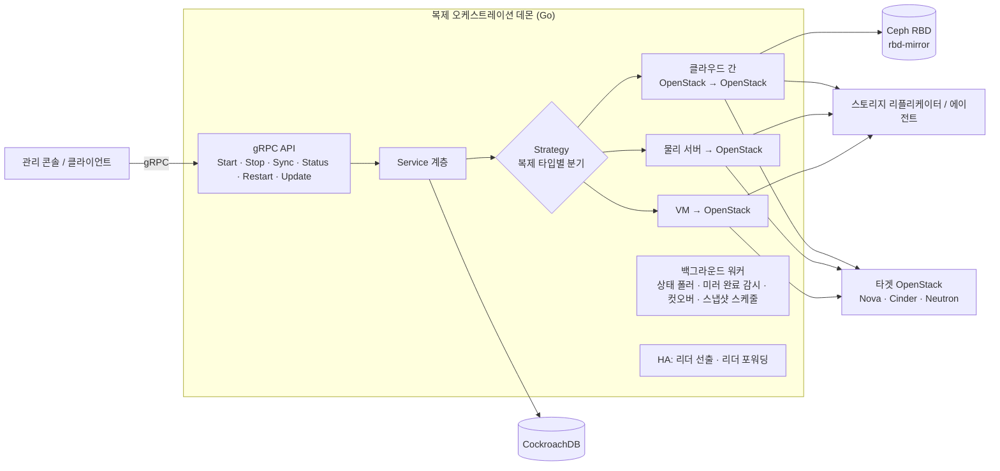

# 🛡️ DR Platform — 재해복구·마이그레이션 복제 오케스트레이션

**OpenStack·Kubernetes 환경의 재해복구(DR), 백업, 물리·VM 마이그레이션을 위한 복제 오케스트레이션 데몬 개발 기록**

`주식회사데이타커맨드` · `2022.01 ~ 현재` · `팀 3명` · `백엔드 개발 (Go)`

> [!NOTE]
> 회사 업무로 개발한 제품이라 **소스 코드와 대외비 정보는 포함하지 않았습니다.**
> 이 저장소는 제가 맡은 역할, 설계한 구조, 문제를 풀어 간 방식과 결과를 공개 가능한 수준으로 정리한 문서입니다.
> 다이어그램과 예시 코드는 이해를 돕기 위해 일반화해 다시 그린 것으로, 실제 제품 코드가 아닙니다.

---

## 💡 한눈에 보기

| 영역 | 내용 |
|---|---|
| **무엇을 만들었나** | 소스 클라우드의 볼륨·서버를 타겟 OpenStack으로 지속 복제하고, 장애 시 전환(컷오버)·시점 복구를 수행하는 **복제 오케스트레이션 데몬** |
| **복제 대상** | OpenStack → OpenStack, 물리 서버(Windows/Linux) → OpenStack, VM(VMware·RHV) → OpenStack, Kubernetes PV 백업 |
| **나의 역할** | 복제 오케스트레이션·HA·복제 경로 설계 등 핵심 개발, 주기별 스냅샷 관리 기능 설계·구현, AI 개발 프로세스 도입·정착 |
| **대표 성과** | 복제 전략 하나를 예상 12주 → **5주**에 개발 · 시나리오 단위 테스트 **2,700건+** · SonarQube 인지복잡도 위반 **96 → 3건** · 운영 전 결함 **6건** 발견 |

---

## 🏗 아키텍처 개요

- **gRPC API + 전략 패턴**: 복제 시작·중지·동기화·상태 조회·재시작·플랜 업데이트를 하나의 API로 제공하고, 복제 타입마다 다른 처리는 Strategy로 분리했습니다.
- **HA**: 여러 노드 중 리더만 쓰기 작업과 스케줄을 처리하고, 다른 노드로 온 요청은 리더로 포워딩합니다.
- **재기동에 강한 설계**: 진행 중인 스냅샷·컷오버·미러 완료 감시 작업을 DB에 기록해, 데몬이 재시작돼도 이어서 처리합니다.

자세한 내용 → [docs/architecture.md](docs/architecture.md)

---

## 🧩 주요 작업

### 1. OpenStack 재해복구(DR) 플랫폼 · 2023.03 ~ 현재
- 복제 오케스트레이션 gRPC API 설계·구현, CockroachDB 스키마·마이그레이션 관리
- 스토리지 조합별 복제 경로 3종 구현: **Ceph → Ceph**(rbd-mirror), **Ceph → Device/File**, **Device/File → Device/File**(멀티 스토리지 배치)
- 복제 실패 시 세션 자동 중지·스토리지 리소스 정리 등 **보상 트랜잭션**
- 성과: 인스턴스별 다중 RPC → 플랜 단위 단일 요청 배치로 처리량 개선, 부분 실패 롤백 버그 수정, 상태 집계·완료 시각 정합성 확보

### 2. 주기별 스냅샷 관리 기능 · 요구사항 정의부터 설계·구현까지 담당
- 분·시·일·주 단위 스케줄(플랜당 최대 4개), 외부 스케줄러·메시지 브로커 연동(리더 노드만 구독)
- 스토리지 타입별 스냅샷 생성·삭제(RBD 스냅샷 / OpenStack 볼륨 스냅샷 / reflink), 유지 개수 기반 자동 정리
- 복제 정지 → 스냅샷 → 재개를 데몬 내부에서 일괄 처리해 일관성 확보

자세한 내용 → [docs/periodic-snapshot.md](docs/periodic-snapshot.md)

### 3. 물리 서버·VM → OpenStack 마이그레이션 · 2023.06 ~ 현재
- 물리 서버 온라인 복제, 디스크 UniqueID 기반 볼륨 매핑, 실패 시 롤백
- **컷오버 워커**: 소스 상태·복제 완료 폴링 → 타겟 전환, 재기동 복구
- RHV → OpenStack 전략을 계약 설계부터 운영 가능 수준까지 **46개 커밋, 5주**에 완성

### 4. Kubernetes DR·백업 솔루션 · 2022.01 ~ 2023.02
- Ceph RBD CSI 스냅샷 파이프라인, Operator SDK 기반 주기 스냅샷·보존 정책, PITR 시나리오 설계
- 트랜잭션 기반 DB 반영과 플랜 단위 동시 실행 직렬화로 대량 스냅샷 정합성 유지

### 5. AI 활용 스펙 주도 개발 · 2025.10 ~ 현재
- AI를 **설계 질문자 · 구현 실행자 · 독립 검증자** 세 역할로 나누고 규칙과 문서로 고정
- 스펙 → 계획 승인 → 실패 테스트 → 구현 → 독립 리뷰 파이프라인 정착
- 주요 작업 합산 약 **18주 단축**, 운영 전 동시성·데이터 정합성 결함 **6건(HIGH 2건)** 발견

자세한 내용 → [docs/ai-workflow.md](docs/ai-workflow.md)

---

## 🧪 품질

- 컷오버·복제 시작·상태 조회 시나리오 단위 테스트 **2,700건+**
- 버그는 재현 실패 테스트부터(Red-Green), 상태 조합은 테이블 테스트로 고정
- 트랜잭션 콜백 분리로 DB 없이 테스트 → SonarQube **new_coverage 80% 게이트 통과**
- 가짜 데몬과 시나리오 러너로 E2E 재현, 헤드리스 Chrome(CDP) 스모크

자세한 내용 → [docs/testing.md](docs/testing.md)

---

## 📚 문서

| 문서 | 내용 |
|---|---|
| [architecture.md](docs/architecture.md) | 데몬 구조, 복제 경로, HA, 재기동 복구 |
| [periodic-snapshot.md](docs/periodic-snapshot.md) | 주기별 스냅샷 관리 기능 설계 |
| [ai-workflow.md](docs/ai-workflow.md) | Claude Code 기반 스펙 주도 개발 방식과 성과 |
| [testing.md](docs/testing.md) | 테스트 전략과 품질 게이트 |

---

## 👤 About

**장용원** · 백엔드 개발자 (재해복구·백업·마이그레이션)
GitHub [@Yongwon-Jang](https://github.com/Yongwon-Jang) · jang93042@gmail.com
