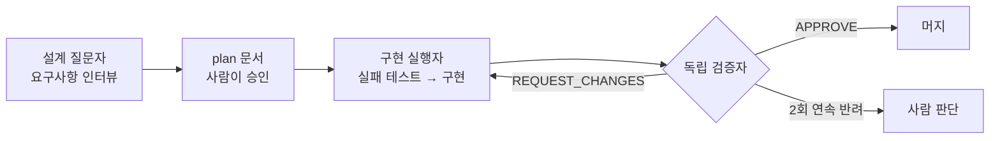

# 🤖 AI 활용 스펙 주도 개발 (Claude Code)

> 2025.10부터 팀 개발 방식으로 도입·정착시킨 방법입니다. 데몬의 세 가지 복제 전략(물리 → OpenStack, OpenStack → OpenStack, RHV → OpenStack)을 설계부터 운영 안정화까지 이 방식으로 개발했습니다.

## 1. 핵심 아이디어: AI를 세 역할로 나눈다

하나의 AI 세션에게 "알아서 만들어 줘"라고 맡기면 빠르지만, 스스로 만든 코드를 스스로 검증하게 되어 결함을 놓치기 쉽습니다.
그래서 역할을 나누고, 각 역할의 규칙을 문서로 고정했습니다.

| 역할 | 하는 일 | 규칙 |
|---|---|---|
| **설계 질문자** | 구현 전에 요구사항을 한 질문씩 인터뷰하고 결정을 plan 문서에 기록 | 작업 크기(S/M/L/XL)에 따라 문서화 수준과 리뷰 레인 수 결정, 되돌릴 수 없는 변경은 정확성·데이터 안전 2개 레인 |
| **구현 실행자** | 스펙 → 계획 → 태스크별 실패 테스트 → 구현 → 통과 확인 | plan 승인 전 구현 금지, 큰 변경은 서브에이전트·서브 브랜치로 병렬화 |
| **독립 검증자** | 구현 세션과 분리된 세션이 읽기 전용으로 재검증 | APPROVE / REQUEST_CHANGES / UNVERIFIED 판정, 같은 결함으로 2회 연속 반려되면 사람에게 에스컬레이션 |

## 2. 맥락을 잃지 않는 장치

- **CLAUDE.md**: 지켜야 할 불변 조건과 코딩 규약을 명시해 세션이 바뀌어도 같은 기준 유지
- **plan 문서 상태 관리**: pending → done으로 설계 문서 상태를 관리
- **프로젝트 메모리·인수인계 문서**: 결정과 보류 사유를 기록
- **커밋 메시지**: 변경 이유와 리뷰에서 잡힌 회귀를 함께 기록
- **완료 기준**: 구현이 끝나면 lint → build → test가 자동으로 돌고, 결과가 있어야만 완료로 인정

## 3. 성과

| 항목 | 결과 |
|---|---|
| RHV → OpenStack 복제 전략 | 계약 설계부터 운영 가능 수준까지 **5주** (46개 커밋, 기존 방식이면 약 12주 예상) |
| Stop/Delete 동시성 재설계 | 13개 파일, +3,846 / −551줄을 서브에이전트 병렬 구현으로 **3일** |
| SonarQube 리팩터링 | 인지복잡도 위반 **96 → 3건**, 중복률 5.9% → 3.9%, 동작 변경 없이 **3일** |
| 테스트 | 단위 테스트 **709개** 작성, new_coverage 80% 게이트 통과 |
| 결함 예방 | 독립 리뷰 루프로 운영 전에 동시성·데이터 정합성 결함 **6건(HIGH 2건)** 발견·수정 |
| 전체 | 주요 작업 합산 약 **18주 단축** |

## 4. 독립 리뷰가 잡아낸 결함 예시

- **리더 교체 중 삭제 작업**: 리더가 바뀌었는데도 이전 리더에서 삭제 작업이 중단되지 않고 끝까지 실행되던 문제
- **성공 상태 선기록**: 작업이 끝나기 전에 성공 상태를 먼저 기록해, 중간에 장애가 나면 복구할 방법이 없던 설계 결함

두 결함 모두 구현 세션 스스로는 "테스트 통과"로 판단했던 것을, 분리된 검증 세션이 상태 전이 순서를 다시 읽으며 찾아냈습니다.

## 5. 배운 점

- AI는 **빠른 구현자**로만 쓰면 속도만 오르지만, **질문자와 검증자**로도 쓰면 품질까지 같이 오릅니다.
- 규칙을 대화가 아니라 **파일(CLAUDE.md, plan 문서)** 에 남겨야 세션이 바뀌어도 같은 기준이 유지됩니다.
- 최종 판단과 승인은 사람이 하고, AI가 반복해서 실패하는 지점은 사람에게 넘기는 **에스컬레이션 규칙**이 중요했습니다.
