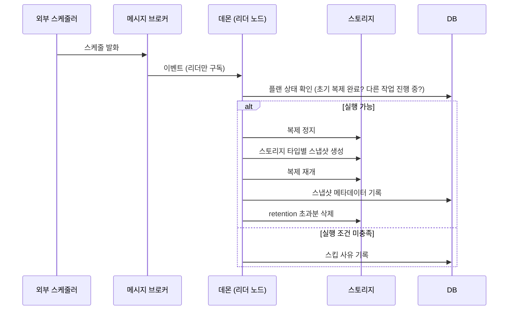

# 📸 주기별 스냅샷 관리 기능

> 요구사항 정의부터 설계·구현까지 담당한 기능입니다. 내부 설계서를 바탕으로 공개 가능한 수준으로 요약했습니다.

## 1. 왜 필요했나

복제는 소스의 **최신 상태**를 타겟에 계속 맞춥니다. 그래서 소스 데이터가 손상되면 그 상태까지 그대로 복제됩니다.
원하는 **과거 시점**으로 되돌릴 수 있도록, 복제 중인 플랜 단위로 스냅샷을 주기적으로 만들고 보관·정리하는 기능을 설계했습니다.

## 2. 요구사항

| 항목 | 결정 |
|---|---|
| 주기 | 분·시·일·주 단위, **플랜당 최대 4개** 스케줄 |
| 보관 위치 | 재해 시에도 남아 있는 **타겟 측** |
| 보관 정책 | 스케줄별 유지 개수(retention)를 넘으면 오래된 것부터 자동 삭제 |
| 수동 생성 | 즉시 생성 요청 + 비동기 상태 폴링 |
| 조회 | 목록·상세 조회 gRPC API |

## 3. 흐름

## 4. 설계 포인트

- **스토리지 타입별 구현 분리**: Ceph는 RBD 스냅샷, Device 스토리지는 OpenStack 볼륨 스냅샷, File 스토리지는 reflink로 같은 인터페이스 뒤에 숨김
- **일관성**: 이전에는 외부에서 정지·재개 API를 따로 호출했지만, 정지 → 스냅샷 → 재개를 **데몬 내부에서 하나의 작업**으로 묶고 기존 외부 정지·재개 API는 폐지
- **실행 조건**: 초기 복제가 끝나기 전 발화는 스킵, 다른 작업(정지·삭제·컷오버)과의 동시 실행은 플랜 상태로 막음
- **HA 환경**: 메시지는 리더 노드만 구독해 같은 스냅샷이 여러 번 만들어지지 않도록 함
- **재기동**: 진행 중이던 스냅샷 작업은 데몬 재시작 후 이어서 처리
